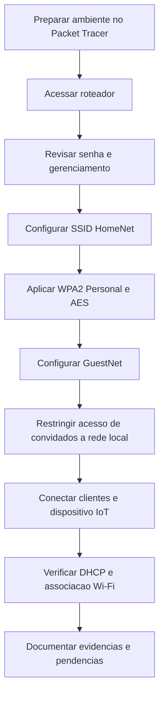

# Laboratório Cisco Networking Academy: Fortalecimento e segurança de roteador sem fio

## Visão geral

Utilizei o Cisco Packet Tracer para trabalhar com configurações de proteção de uma rede doméstica. A atividade aborda a senha administrativa do roteador, a segurança das redes WiFi, a conexão de clientes e dispositivos IoT e o isolamento da rede de convidados.

O objetivo é entender como configurações simples podem reduzir riscos de acesso indevido e como verificar a conectividade depois de aplicar mudanças.

## Objetivos de aprendizagem

- Entender por que é importante alterar a senha padrão do roteador e restringir o gerenciamento remoto.
- Configurar identificação e proteção das redes sem fio com WPA2 Personal e AES.
- Conectar notebooks e dispositivos IoT à rede correta.
- Verificar endereçamento automático via DHCP.
- Compreender o isolamento entre a rede principal e a rede de convidados.

## Topologia ilustrativa

*Topologia ilustrativa elaborada para documentar o laboratório realizado na Cisco Networking Academy. A representação é parcial e didática: as capturas não comprovam as portas físicas ou todos os enlaces entre dispositivos.*

O cenário físico também inclui ambientes residenciais e um caminho externo representado por ISP/Telco e Data Center. Outros dispositivos mencionados no exercício, como Home_Siren e Home Door, não possuem configuração comprovada nas capturas enviadas.

## Configurações identificadas

### Endereçamento

| Dispositivo | Interface | IP | Máscara | Gateway | DNS |
|---|---|---|---|---|---|
| Roteador sem fio | Interface de gerenciamento | 192.168.0.1 | Não verificada | Não se aplica | Não verificado |
| Home Office PC | FastEthernet0 | 192.168.0.100 | 255.255.255.0 | 192.168.0.1 | 10.2.0.125 |
| Home_Webcam | Wireless0 | 192.168.0.106 | 255.255.255.0 | Não verificado | Não verificado |
| Home Laptop 1 | Adaptador Wireless-N | Não verificado | Não verificada | Não verificado | Não verificado |
| Home Laptop 2 | Não verificada | Não verificado | Não verificada | Não verificado | Não verificado |

O PC e a webcam aparecem com DHCP selecionado. Os endereços são do ambiente simulado.

### Roteador: redes Wi-Fi

| Parâmetro | HomeNet | GuestNet |
|---|---|---|
| Finalidade | Rede principal | Rede de convidados |
| Faixas | 2,4 GHz; 5 GHz-1; 5 GHz-2 | Perfis de 2,4 GHz e 5 GHz exibidos |
| Transmissão do SSID | Habilitada nas três faixas | Habilitada nas faixas visíveis |
| Segurança | WPA2 Personal | WPA2 Personal |
| Criptografia | AES | AES |
| Senha pré-compartilhada | Configurada na simulação | Configurada na simulação |
| Acesso à rede local | Rede principal | Caixa de acesso à rede local desmarcada na captura |

### Administração do roteador

| Parâmetro | Evidência |
|---|---|
| Acesso à interface web | 192.168.0.1 |
| Senha administrativa | Campos preenchidos e mascarados na captura |
| Gerenciamento remoto | **Enabled** selecionado na captura enviada |
| Porta de gerenciamento remoto | 8080 |
| Desativação efetiva do gerenciamento remoto | Comprovada |

### Clientes sem fio e IoT

| Dispositivo | Configuração observada | Resultado visível |
|---|---|---|
| Home Laptop 1 | Adaptador Wireless-N, conexão ao ponto de acesso | Mensagem de conexão bem-sucedida |
| Home Laptop 2 | GuestNet prevista no roteiro | Sem captura individual de validação |
| Home_Webcam | SSID HomeNet, WPA2-PSK, AES, DHCP | IP 192.168.0.106 atribuído |
| Home_Siren | Configuração prevista no roteiro | Não verificada |
| Home Door | Configuração prevista no roteiro | Não verificada |

## Etapas documentadas

1. **Administração:** acesso à interface web do roteador e preenchimento dos campos de alteração da senha administrativa.
2. **Rede principal:** definição do SSID HomeNet e habilitação de sua divulgação nas três faixas exibidas.
3. **Proteção Wi-Fi:** seleção de WPA2 Personal com criptografia AES para as redes principais.
4. **Rede de convidados:** configuração dos perfis GuestNet com WPA2 Personal/AES e desmarcação da opção que permite acesso à rede local.
5. **Clientes:** conexão de notebook ao ponto de acesso e configuração da webcam na rede HomeNet.
6. **Endereçamento:** verificação de DHCP no PC e na webcam.

As etapas representam o que está registrado nas imagens. O roteiro também prevê testes de acesso à Internet, ping entre redes e desativação do gerenciamento remoto, mas não foram fornecidas evidências conclusivas dessas validações.

## Fluxograma do processo

## Testes e validações

| Verificação | Resultado observado | Evidência |
|---|---|---|
| SSID HomeNet nas três faixas | Configuração exibida | [SSID HomeNet](assets/evidencias/ssid-homenet.png) |
| WPA2 Personal e AES | Configuração exibida | [Segurança Wi-Fi](assets/evidencias/seguranca-wifi.png) |
| Perfil GuestNet | Configuração e opção de acesso local desmarcada | [Rede de convidados](assets/evidencias/rede-convidados.png) |
| Associação do notebook ao ponto de acesso | Mensagem de sucesso | [Conexão do notebook](assets/evidencias/conexao-notebook.png) |
| DHCP do PC | IP 192.168.0.100 exibido | [DHCP do PC](assets/evidencias/dhcp-pc.png) |
| DHCP da webcam | IP 192.168.0.106 exibido | [Webcam IoT](assets/evidencias/webcam-iot.png) |
| Desativação do gerenciamento remoto | Não comprovada; captura indica habilitado | [Administração](assets/evidencias/administracao-roteador.png) |
| Acesso ao site de teste | Não verificado nas capturas | Sem evidência |
| Ping de GuestNet para HomeNet após isolamento | Não verificado nas capturas | Sem evidência |

## Conhecimentos adquiridos

O laboratório ajudou a relacionar **configuração de redes** com **segurança da informação**. WPA2 com AES protege o tráfego sem fio; DHCP simplifica a distribuição de endereços; e uma rede de convidados separada pode limitar o acesso aos dispositivos da rede principal, desde que o isolamento seja aplicado e testado.

Também reforçou a importância de verificar as configurações depois de salvá-las. Uma opção marcada na interface não é, por si só, prova de que todos os testes de segurança foram concluídos.

Esses conceitos são úteis no suporte de TI para investigar falhas de conexão, conferir configurações de rede e identificar exposições desnecessárias.

## Referência

- Cisco Networking Academy (NetAcad), atividade educacional **PT Packet Tracer - Configurar o fortalecimento e a segurança do roteador sem fio** (material disponibilizado no curso).

## Observação sobre evidências

As imagens são capturas da execução em ambiente simulado. Antes de tornar o repositório público, oculte as senhas pré-compartilhadas que aparecem em texto claro nas capturas de segurança, convidados e webcam. Não publique o arquivo original da atividade sem confirmar a permissão de redistribuição.

