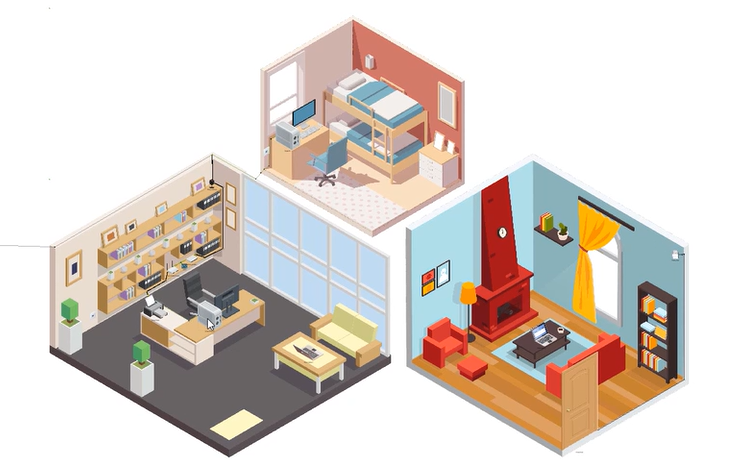
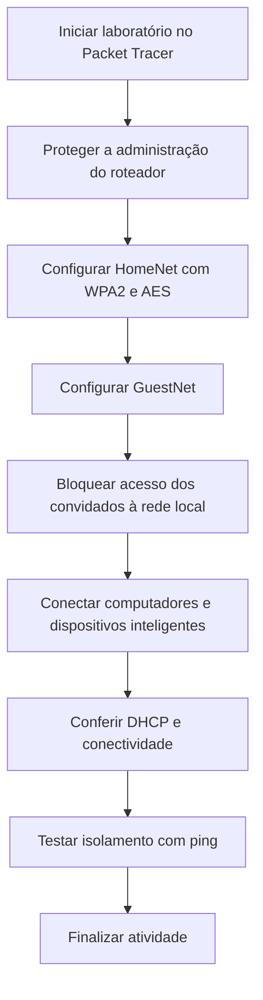

# Segurança de roteador Wireless

## Visão geral

Neste laboratório da **Cisco Networking Academy (NetAcad)**, utilizei o **Cisco Packet Tracer** para estudar como proteger um roteador doméstico, configurar uma rede principal e outra para convidados e conectar computadores e dispositivos inteligentes.

A atividade também aborda como verificar a conectividade e restringir o acesso dos convidados à rede principal. As capturas de tela ilustram o ambiente simulado; as senhas exibidas pertencem ao exercício.

---

## Objetivos

- Substituir a senha padrão de administração do roteador.
- Desativar o gerenciamento remoto desnecessário.
- Configurar e proteger as redes **HomeNet** e **GuestNet**.
- Conectar computadores e dispositivos inteligentes utilizando Wireless e DHCP.
- Verificar a conectividade e o isolamento da rede de convidados.
  

---

## Etapas do laboratório

1. Acessar a página do roteador pelo navegador do PC.
2. Alterar a senha administrativa e desativar o gerenciamento remoto.
3. Configurar a HomeNet nas faixas de 2,4 GHz e 5 GHz.
4. Aplicar WPA2 Personal e AES à rede principal.
5. Criar a GuestNet com uma senha própria.
6. Bloquear o acesso dos convidados à rede local.
7. Conectar os notebooks e dispositivos inteligentes às redes correspondentes.
8. Conferir os endereços IP atribuídos por DHCP e a conectividade.
9. Utilizar o comando `ping` para verificar a comunicação entre as redes antes e depois do isolamento.

---

## Fluxograma do processo

---

## Onde esse conhecimento pode ser aplicado?

### Cenário fictício: visitantes no escritório

**Situação:** uma pequena empresa recebe clientes e fornecedores que precisam usar a Internet. No mesmo local, os funcionários utilizam notebooks e dispositivos inteligentes conectados à rede interna.

**Aplicação:** o profissional de Suporte de TI configura uma rede Wireless para os funcionários e outra para os visitantes, com senhas diferentes. Também restringe o acesso dos convidados aos equipamentos da rede principal.

**Benefício:** os visitantes podem navegar na Internet sem ter acesso direto aos dispositivos internos. Esse exemplo aplica os conceitos de **HomeNet, GuestNet, WPA2 Personal, AES e isolamento de rede** estudados no laboratório.

---

## Configurações do laboratório

### 1. Administração do roteador

A proteção começa pela página de administração, para impedir que pessoas não autorizadas alterem as configurações da rede.

| Parâmetro | Configuração abordada |
|---|---|
| Endereço de administração | `192.168.0.1` |
| Senha administrativa | Substituição da senha padrão |
| Gerenciamento remoto | Desativação do acesso pela Internet |

---

### 2. Rede principal: HomeNet

A HomeNet representa a rede utilizada pelos moradores e pelos dispositivos inteligentes.

| Parâmetro | Configuração do exercício |
|---|---|
| SSID | `HomeNet` |
| Faixas | 2,4 GHz, 5 GHz-1 e 5 GHz-2 |
| Divulgação do SSID | Habilitada |
| Segurança | WPA2 Personal |
| Criptografia | AES |

---

### 3. Rede de convidados: GuestNet

A GuestNet foi utilizada para estudar como oferecer acesso Wireless a visitantes sem permitir acesso aos dispositivos da rede principal.

| Parâmetro | Configuração do exercício |
|---|---|
| SSID | `GuestNet` |
| Perfil de convidados | Habilitado nas três faixas |
| Segurança | WPA2 Personal |
| Criptografia | AES |
| Acesso à rede local | Bloqueado para convidados |

---

### 4. Computadores e dispositivos inteligentes

| Dispositivo | Rede ou conexão | Configuração abordada |
|---|---|---|
| Home Office PC | Cabo de rede | DHCP e acesso à página do roteador |
| Home Laptop 1 | HomeNet | Conexão Wireless com WPA2 Personal |
| Home Laptop 2 | GuestNet | Conexão à rede de convidados |
| Home_Webcam | HomeNet | WPA2-PSK, AES e DHCP |
| Home_Siren | HomeNet | Conexão Wireless e DHCP |
| Home Door | HomeNet | Conexão Wireless e DHCP |

---

### Endereçamento de referência

| Item | Endereço |
|---|---|
| Rede local | `192.168.0.0/24` |
| Roteador / gateway | `192.168.0.1` |
| Máscara de rede | `255.255.255.0` |

Os endereços individuais dos dispositivos não foram informados. O DHCP foi abordado como forma de atribuir endereços IP automaticamente.

---

## Testes propostos na atividade

| Teste | Objetivo |
|---|---|
| Conexão Wireless | Verificar se o dispositivo se conecta à rede escolhida |
| Endereço IP por DHCP | Verificar se o equipamento recebe um endereço automaticamente |
| Acesso ao site de teste | Verificar a comunicação com a rede externa simulada |
| `ping` antes do isolamento | Investigar se existe comunicação entre convidados e rede principal |
| `ping` após o isolamento | Verificar se a comunicação com a rede principal foi bloqueada |

---

## O que aprendi

Este laboratório reforçou a importância de trocar senhas padrão, limitar o acesso administrativo e proteger conexões Wireless com autenticação e criptografia.

Também ajudou a compreender como uma rede de convidados pode reduzir o acesso indevido aos dispositivos da rede principal e como o DHCP facilita a conexão de novos equipamentos. Esses conhecimentos são úteis em **Suporte de TI, Redes e Cybersecurity**, especialmente na configuração de redes e na investigação de problemas de conectividade.

---

## Entendendo os termos técnicos

| Termo | Explicação simples |
|---|---|
| Roteador | Equipamento que conecta os dispositivos da casa ou empresa a outras redes, como a Internet. |
| Wireless | Conexão de rede sem o uso de cabos entre o dispositivo e o ponto de acesso. |
| SSID | Nome da rede que aparece quando procuramos uma conexão Wireless. |
| WPA2 Personal | Proteção que permite conectar à rede usando uma senha compartilhada. |
| AES | Tecnologia que ajuda a proteger as informações transmitidas pela rede. |
| DHCP | Serviço que entrega automaticamente um endereço IP aos dispositivos. |
| Gateway | Endereço do equipamento usado para acessar outras redes. |
| Isolamento de convidados | Restrição que impede visitantes de acessar equipamentos da rede principal. |
