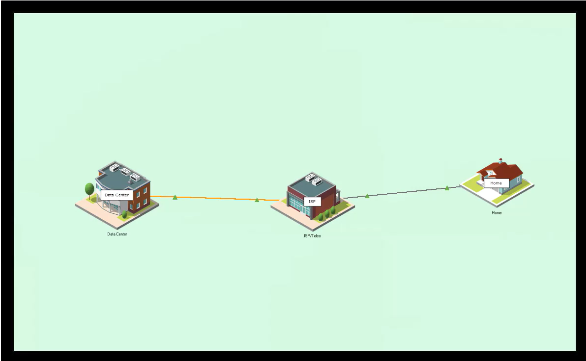
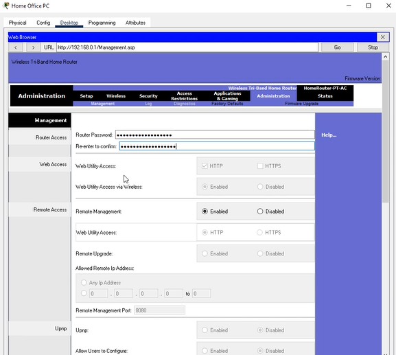
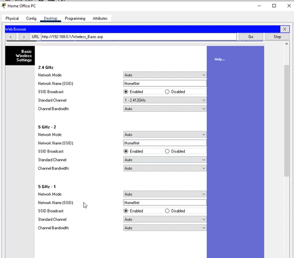
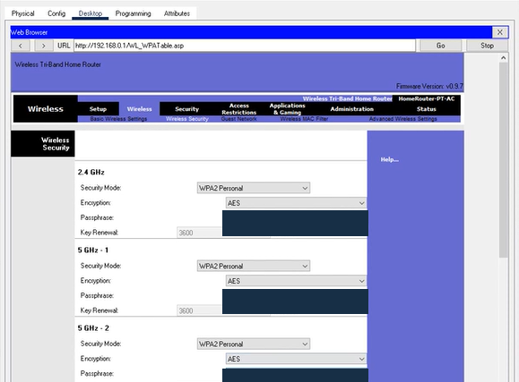
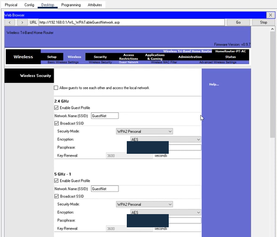
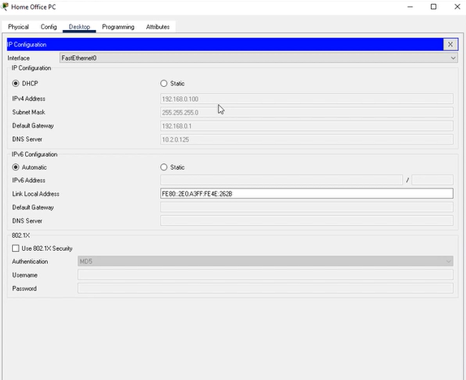
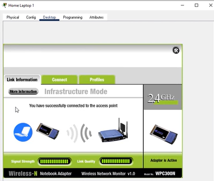
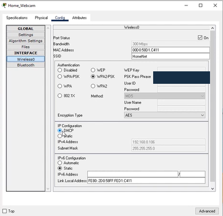
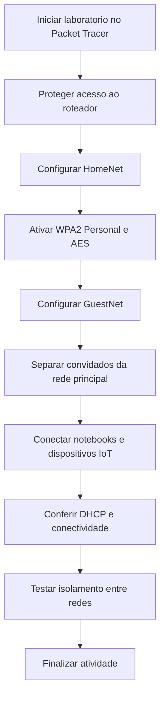

# Laboratório Cisco Networking Academy: Segurança de roteador Wireless 

## Sobre o laboratório

Com Cisco Packet Tracer a atividade mostra como proteger o acesso ao roteador, configurar redes para moradores e convidados e conectar computadores e dispositivos inteligentes. Também aborda como conferir se a rede está funcionando e se os convidados estão separados da rede principal.

As capturas de tela foram incluídas apenas para ilustrar as etapas em um ambiente simulado. As senhas mostradas nas telas pertencem ao exercício.

---

## O que pratiquei

- Trocar a senha padrão de administração do roteador.
- Desativar o gerenciamento remoto quando ele não for necessário.
- Configurar a rede principal **HomeNet** e a rede de convidados **GuestNet**.
- Proteger as redes WiFi com **WPA2 Personal** e **AES**.
- Conectar notebooks e dispositivos inteligentes à rede.
- Usar **DHCP** para receber endereços IP automaticamente.
- Separar a rede de convidados da rede principal.

---

## Ferramenta e cenário

| Item | Descrição |
|---|---|
| Plataforma | Cisco Networking Academy (NetAcad) |
| Simulador | Cisco Packet Tracer |
| Equipamento central | Roteador sem fio doméstico |
| Redes Wireless | HomeNet (principal) e GuestNet (convidados) |
| Dispositivos do exercício | PC, notebooks, webcam, sirene e porta inteligente |
| Conexão externa | ISP/Telco e Data Center no cenário do curso |

---

## Configurações do laboratório

### 1. Administração do roteador

A primeira parte é proteger a página de configuração do roteador, evitando que qualquer pessoa com a senha padrão possa alterar a rede.

| Configuração | O que foi trabalhado |
|---|---|
| Endereço do roteador | `192.168.0.1` |
| Senha de administração | Substituição da senha padrão |
| Gerenciamento remoto | Desativação do acesso pela Internet |

---

### 2. Rede WiFi principal: HomeNet

A rede principal foi usada para estudar a configuração do nome da rede (SSID) e a proteção das conexões sem fio.

| Parâmetro | Configuração do exercício |
|---|---|
| SSID | `HomeNet` |
| Frequências | 2,4 GHz, 5 GHz-1 e 5 GHz-2 |
| Divulgação do nome da rede | Habilitada |
| Segurança | WPA2 Personal |
| Criptografia | AES |

**SSID** é o nome que aparece na lista de redes Wireless. **WPA2 Personal** é o tipo de proteção usado na conexão, e **AES** é o método que ajuda a proteger os dados transmitidos.

---

### 3. Rede de convidados: GuestNet

A GuestNet permite oferecer WiFi a visitantes sem liberar o acesso aos dispositivos da rede principal.

| Parâmetro | Configuração do exercício |
|---|---|
| SSID | `GuestNet` |
| Perfil de convidados | Habilitado nas três faixas |
| Segurança | WPA2 Personal |
| Criptografia | AES |
| Acesso à rede local | Bloqueado para convidados |

---

### 4. Computadores e dispositivos inteligentes

Os dispositivos precisam usar a rede e a senha corretas. O exercício também utiliza DHCP, que entrega automaticamente um endereço IP aos equipamentos.

| Dispositivo | Rede ou conexão | Configuração abordada |
|---|---|---|
| Home Office PC | Cabo de rede | DHCP e acesso à página do roteador |
| Home Laptop 1 | HomeNet | Conexão Wi-Fi com WPA2 Personal |
| Home Laptop 2 | GuestNet | Conexão à rede de convidados |
| Home_Webcam | HomeNet | WPA2-PSK, AES e DHCP |
| Home_Siren | HomeNet | Configuração de Wi-Fi e DHCP |
| Home Door | HomeNet | Configuração de Wi-Fi e DHCP |

#### Endereçamento de referência

| Item | Endereço |
|---|---|
| Rede local | `192.168.0.0/24` |
| Roteador / gateway | `192.168.0.1` |
| Máscara de rede | `255.255.255.0` |

---

## Passo a passo resumido

1. Acessar o roteador pelo navegador do PC.
2. Alterar a senha administrativa e desativar o gerenciamento remoto.
3. Definir o nome **HomeNet** nas redes de 2,4 GHz e 5 GHz.
4. Aplicar **WPA2 Personal** e **AES** para proteger o Wi-Fi.
5. Criar a rede **GuestNet** com senha própria.
6. Impedir que convidados acessem os dispositivos da rede principal.
7. Conectar os notebooks e dispositivos inteligentes às redes correspondentes.
8. Conferir os endereços recebidos por DHCP e testar a conexão.
9. Testar a separação entre GuestNet e HomeNet com o comando `ping`.

---

## Fluxograma do processo

## Testes propostos na atividade

| Teste | Para que serve |
|---|---|
| Conexão Wireless | Conferir se o dispositivo consegue entrar na rede escolhida |
| Endereço IP via DHCP | Conferir se o equipamento recebe um endereço automaticamente |
| Acesso ao site de teste | Conferir a comunicação com a rede externa simulada |
| `ping` entre redes | Entender se um convidado consegue acessar um dispositivo da rede principal |
| Novo `ping` após o isolamento | Conferir o bloqueio da comunicação entre as redes |

---

## O que aprendi

Este laboratório ajudou a entender que a segurança de uma rede começa com configurações simples, como trocar senhas padrão, proteger o Wireless e limitar acessos desnecessários.

Também reforçou a diferença entre a rede principal e a rede de convidados, além da função do DHCP na conexão dos equipamentos. Esses conhecimentos são úteis em **Suporte de TI, Redes e Cybersecurity**, especialmente para configurar redes e investigar problemas de conectividade.
